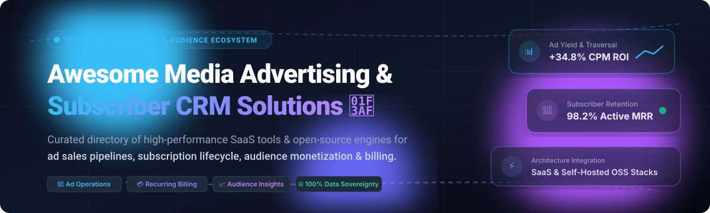

# 📺 Awesome Media Advertising & Subscriber CRM 🚀

  
  
  
  
  
  
  

  <b>A curated catalog of elite SaaS suites and high-performance open-source engines for media ad sales pipelines, subscription lifecycle, audience monetization, campaign trafficking, and recurring billing.</b>

  Built for media publishers, OTT broadcasters, print syndicates, ad ops specialists, and revenue engineering teams.

---

## 📑 Table of Contents
- [🔍 Sector Overview & Market Dynamics](#-sector-overview--market-dynamics)
- [☁️ SaaS & Hosted Platforms](#️-saas--hosted-platforms)
- [💻 Open-Source GitHub Projects](#-open-source-github-projects)
- [🛠️ Architecture Blueprint for Custom Media CRM Stacks](#️-architecture-blueprint-for-custom-media-crm-stacks)
- [🤝 How to Contribute](#-how-to-contribute)
- [📈 Star History](#-star-history)
- [💖 Support & Sponsorship](#-support--sponsorship)
- [⚖️ Disclaimer](#️-disclaimer)

---

## 🔍 Sector Overview & Market Dynamics

The global Media Advertising & Subscriber Management software market is estimated at **$18.5 Billion in 2026** (growing at ~11.8% CAGR toward $29B+ by 2030), propelled by converging hybrid business models (CTV/AVOD, retail media networks, and tiered reader paywalls). The sector exhibits **moderate fragmentation with specialized oligopolies**: enterprise linear/digital broadcast ad operations and agency billing are concentrated among legacy mission-critical backbones (Salesforce, Mediaocean, WideOrbit), whereas digital-first subscription management, paywall metering, and self-hosted ad-tech remain highly fragmented across innovative SaaS contenders and fast-growing open-source frameworks.

---

## ☁️ SaaS & Hosted Platforms

Below is a curated matrix of industry-leading commercial platforms for media ad sales, linear/streaming ad trafficking, and subscriber relationship management, sorted by company size, valuation, and enterprise scale (descending):

| Platform | Company Valuation / Revenue Tier | Pricing (Specific Starting Tiers) | Free Tier Limits / Trial Specifics | Core Media Capabilities |
| :--- | :--- | :--- | :--- | :--- |
| **[Salesforce Media Cloud](https://www.salesforce.com/media/)** | **~$280B+ Market Cap** (~$38B Annual Revenue) | **$500 /user/month** (Enterprise Edition) or **$725 /user/month** (Unlimited Edition), billed annually | **30-day free trial** with preloaded media ad sales schema, order management, and subscriber sandbox data (up to 5 users, no credit card required) | Comprehensive publisher ad sales management, subscriber lifecycle journeys, subscriber care workspaces, and unified audience segmentation. |
| **[Mediaocean](https://www.mediaocean.com/)** | **~$2.5B Valuation** (~$400M+ Annual Revenue, CVC/TA Associates) | Starting at **$3,000 /month** platform base fee + agency volume spend tiers | **14-day guided proof-of-concept trial** for qualified media buyers/agencies with sandbox API access (restricted to non-live testing environments) | Global advertising workflow automation, omnichannel media management infrastructure connecting buyers, brands, agencies, and sellers. |
| **[WideOrbit](https://www.wideorbit.com/)** | **~$1.2B Acquisition** (Acquired by Lumine Group / Constellation Software) | Starting at **$1,500 /station/month** (WO Traffic standard tier) | **30-day staging demo sandbox** for licensed broadcast partners and network operators (requires account executive qualification, limited to test station database) | Broadcast industry standard ad sales, proposal management, traffic scheduling, linear & digital inventory optimization, and billing reconciliation. |
| **[Operative](https://www.operative.com/)** | **~$500M Valuation** (~$100M+ Annual Revenue, Francisco Partners) | Starting at **$2,500 /month** for Operative.One Core base deployment | **14-day sandbox access** for enterprise broadcasters and publishers following an architecture review (limited to 5 demo advertiser accounts) | Advanced media business management platform (AOS), linear and digital ad inventory yield management, unified order processing, and ad CRM. |
| **[Naviga](https://www.navigaglobal.com/)** | **~$350M Valuation** (~$90M+ Annual Revenue, Vista Equity Partners) | Starting at **$1,200 /month** for Naviga Ad / Naviga Sub modular license | **30-day proof-of-concept trial** upon sales qualification (limited to staging server with sample newspaper/magazine distribution feeds) | Unified publishing software covering subscriber fulfillment, circulating access, digital paywalls, and cross-channel ad booking. |
| **[Lineup Systems](https://www.lineup.com/)** | **~$120M Valuation** (~$25M+ Annual Revenue) | Starting at **$1,000 /month** (AdPoint Core package) | **14-day test environment** with sample publication catalogs, advertiser profiles, and rate card simulation (restricted to 3 administrative users) | Multi-channel media ad booking engine, lead-to-cash AdPoint CRM, rate card governance, audience targeting, and real-time sales pipeline visibility. |
| **[ADmantX](https://www.admantx.com/)** | **~$50M Acquisition** (Acquired by Engineering Group / Expandi) | Starting at **$500 /month** for contextual data API (or $0.08 CPM ad volume pricing) | **14-day free API developer sandbox** limited to 50,000 document/content analysis requests and 5 domain queries | Advanced natural language semantic analysis for contextual advertising, audience sentiment targeting, and brand safety filtering. |
| **[Matrix Solutions](https://www.matrixsolutions.com/)** | **~$40M Valuation** (~$15M+ Annual Revenue) | Starting at **$450 /seat/month** (Monarch media sales CRM) | **30-day evaluation trial** for broadcast sales teams (capped at 5 sales rep seats and 50 account imports) | Specialized media ad sales CRM & intelligence platform connecting ad networks, buyers, and broadcast networks with automated sales alerts. |
| **[Mirada Media](https://www.mirada.tv/)** | **~$25M Market Cap / Valuation** (AIM-listed / Private) | Starting at **$2,000 /month** platform licensing fee for Iris ecosystem | **30-day staging sandbox** for pay-TV operators and OTT networks (includes virtual set-top box emulator and 100 test subscriber profiles) | Subscriber lifecycle analytics, multiscreen content distribution, targeted promo placements, and audience engagement CRM for TV/OTT operators. |
| **[Plannet Media](https://www.plannetmedia.com/)** | **~$15M Valuation** (~$4M Annual Revenue) | Starting at **$350 /month** per team workspace | **14-day full feature free trial** with full access to ad scheduling tools (capped at 10 active media plan projects and 100 media assets) | Intuitive media planning, ad flight scheduling, RFP pipeline tracking, and agency-to-publisher collaborative CRM. |

---

## 💻 Open-Source GitHub Projects

Explore top-rated, self-hosted, and transparent open-source software for ad serving, paywall & subscription metering, marketing automation, audience analytics, and extensible CRM. 

The repositories below are ranked by GitHub Star count (descending), with dedicated badges linking directly to their stargazers community:

| Project & Repository | Stars | Category / Focus | Key Features for Media & Publishing |
| :--- | :--- | :--- | :--- |
| **[Twenty](https://github.com/twentyhq/twenty)** |  | Modern CRM | High-performance open-source CRM featuring extensible custom objects (Advertisers, Insertion Orders, Rate Cards), GraphQL APIs, and rich pipeline management. |
| **[Plausible Analytics](https://github.com/plausible/analytics)** |  | Audience Analytics | Lightweight (&lt;1 KB script), cookie-free, GDPR/CCPA compliant audience tracking ideal for digital media publishers monitoring reader traffic without privacy penalties. |
| **[Listmonk](https://github.com/knadh/listmonk)** |  | Subscriber Communications | High-throughput newsletter engine written in Go and PostgreSQL; delivers millions of subscriber digests, transactional notifications, and segmentation queries. |
| **[Matomo](https://github.com/matomo-org/matomo)** |  | Media Audience Intelligence | Comprehensive self-hosted web analytics platform delivering 100% data ownership, paywall conversion tracking, heatmaps, and custom dimension reporting. |
| **[Mautic](https://github.com/mautic/mautic)** |  | Marketing Automation | Complete audience lifecycle automation engine: lead scoring for ad sponsors, dynamic landing pages, drip onboarding for readers, and campaign automation. |
| **[Lago](https://github.com/getlago/lago)** |  | Metered Billing & Subscriptions | Open-source usage-based billing architecture. Perfect for metered reader paywalls, hybrid subscriber models, credit buckets, and multi-gateway payment processing. |
| **[SuiteCRM](https://github.com/SuiteCRM/SuiteCRM)** |  | Enterprise Media Sales CRM | Robust, battle-tested open-source CRM with modules for contract workflows, ad sales pipelines, customer support cases, and ERP synchronization. |
| **[EspoCRM](https://github.com/espocrm/espocrm)** |  | Modular Sales CRM | Ultra-fast SPA interface with flexible entity builders, BPMN workflow engine, email client integration, and role-based permissions for media account managers. |
| **[Autumn](https://github.com/useautumn/autumn)** |  | Pricing & Entitlement Engine | Modular billing layer connecting Stripe to media portals; powers access paywalls, feature gating, and custom subscription tiers with minimal integration code. |
| **[Revive Adserver](https://github.com/revive-adserver/revive-adserver)** |  | Dedicated Ad Serving Engine | Veteran open-source ad server powering billions of impressions with zone-based targeting, frequency capping, click/conversion tracking, and VAST2 video ad support. |
| **[Meteroid](https://github.com/meteroid-oss/meteroid)** |  | High-Performance Billing | Rust-powered billing engine architected for microsecond event metering, coupon lifecycle management, international taxation, and high-frequency digital media billing. |
| **[BillaBear](https://github.com/billabear/billabear)** |  | Subscription Management | Subscription infrastructure with automated dunning workflows, EU VAT tax compliance, churn analytics, credit notes, and self-service customer portal. |
| **[Open Payment Host](https://github.com/abishekmuthian/open-payment-host)** |  | Payment Gateway Host | Self-hosted payment orchestrator supporting Stripe, PayPal, Square, and Razorpay for processing one-time supporter payments and recurring sponsorships. |
| **[Open Ad Server](https://github.com/ediboko1980/openadserver)** |  | ML Ad Serving & OpenRTB | Python/FastAPI self-hosted ad server featuring DeepFM & Logistic Regression CTR predictive models, OpenRTB compatibility, and Prometheus observability metrics. |
| **[django-subscription-midtrans](https://github.com/rissets/django-subscription-midtrans)** |  | Web Subscription Framework | Django subscription scaffolding incorporating Midtrans payment gateway, automated renewal handling, and asynchronous Celery tasks. |

---

## 🛠️ Architecture Blueprint for Custom Media CRM Stacks

To achieve **100% data sovereignty**, publishers can assemble a composable, production-ready media CRM stack:
1. **Ad Trafficking & Serving**: Deploy [Revive Adserver](https://github.com/revive-adserver/revive-adserver) or [Open Ad Server](https://github.com/ediboko1980/openadserver) for direct-sold ads and private marketplace deals.
2. **Subscriber Monetization & Paywall**: Integrate [Lago](https://github.com/getlago/lago) or [Autumn](https://github.com/useautumn/autumn) for dynamic paywalls and metered reading limits.
3. **Advertiser Relationship Management**: Customize [Twenty](https://github.com/twentyhq/twenty) or [EspoCRM](https://github.com/espocrm/espocrm) with custom entities for Insertion Orders (IO), rate cards, and delivery tracking.
4. **Audience Communications & Insights**: Couple [Listmonk](https://github.com/knadh/listmonk) for newsletters with [Matomo](https://github.com/matomo-org/matomo) or [Plausible](https://github.com/plausible/analytics) for privacy-friendly audience measurement.

---

## 🤝 How to Contribute

Contributions are warmly encouraged! Help keep this ecosystem comprehensive, transparent, and up-to-date:

1. 🍴 **Fork the repo** to your GitHub profile.
2. 🌿 **Create a feature branch** (`git checkout -b feature/new-media-crm-tool`).
3. 📝 **Add or update entries** in `README.md` keeping the standard tabular formatting and factual pricing/stars badges.
4. 🚀 **Submit a Pull Request** with a descriptive summary of your additions.

---

## 📈 Star History

---

## 💖 Support & Sponsorship

Thank you for visiting and supporting the **Awesome Media Advertising & Subscriber CRM** resource list! 🌟

If you find this repository valuable for your organization, development research, or media stack architecture:
- ⭐ **Star this repository** to help other media engineers and publishers discover it.
- 🍴 **Fork and share** it with your media engineering, ad ops, and revenue teams.
- ☕ **Sponsor the maintainer** or buy a coffee to fuel continuous open-source curation via the [GitHub Sponsor Dashboard](https://github.com/sponsors/ishandutta2007).

Your backing ensures independent, data-sovereign media tech curation stays vibrant and open to all! 🚀

---

## ⚖️ Disclaimer

- This directory is an independent **community-curated index** and does not constitute a formal commercial endorsement.
- All media CRM and ad-tech implementations must comply with relevant telecommunications, advertising regulations, and consumer privacy standards (GDPR, CCPA, CPRA).
- Enterprise operators must review self-hosted open-source software for security compliance, data encryption, and high-availability operational requirements.

---

  Maintained with ❤️ by <a href="https://github.com/ishandutta2007">Ishan Dutta</a> and the global open-source media technology community.

